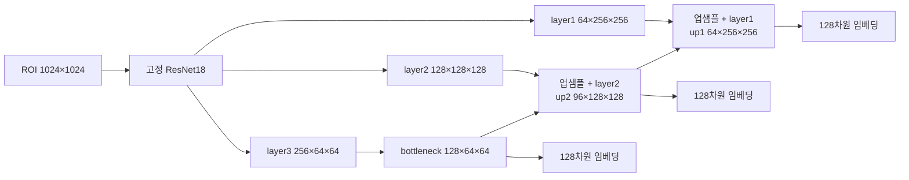

# U-Net ROI 대조학습 모델 구조

## 입력과 역할

모델은 기종 `3029C003AA` 또는 `3029C009AA`의 **스텝 1~12**에서 정상 ROI 분포를 학습한다. 기종은 입력으로 알고 있으며, U-Net이 기종이나 스텝 클래스를 직접 출력하지 않는다. 예상 스텝이 주어지면 해당 스텝의 정상 임베딩 저장소와 비교해 PASS/FAIL을 낸다.

1. 기존 Faster R-CNN의 최고 점수 박스를 사용한다. 추론 시 검출기가 예측한 스텝 클래스는 버리고 박스만 쓴다. 박스 점수 0.25 미만 또는 박스 없음은 `NO_ROI`다.
2. 박스에 사방 10% 여백을 더해 crop한 뒤 비율을 유지하며 확대하고, **1024×1024 회색 캔버스** 중앙에 놓는다. 패딩을 제외하는 마스크도 만든다.
3. ROI 이미지를 정규화해 **기존 ROI 대조학습 ResNet18 인코더**에 넣는다. 인코더는 이전 실험에서 일부 레이어를 학습한 체크포인트이며, **U-Net 학습 중에는 모든 가중치를 고정**한다.

## 특징맵과 디코더

1024×1024 입력에서 사용하는 ResNet18 특징맵 크기는 다음과 같다. `layer4`는 이 U-Net 경로에 넣지 않는다.

| 단계 | 특징맵 크기 `(채널, 높이, 너비)` | 처리 |
|---|---:|---|
| `layer1` | 64 × 256 × 256 | 고해상도 skip 연결 |
| `layer2` | 128 × 128 × 128 | 중간 skip 연결 |
| `layer3` | 256 × 64 × 64 | 디코더 입력 |
| `bottleneck` | 128 × 64 × 64 | `layer3`에 3×3 Conv 두 번, GroupNorm, SiLU |
| `up2` | 96 × 128 × 128 | bottleneck을 업샘플하고 `layer2`와 결합 |
| `up1` | 64 × 256 × 256 | `up2`를 업샘플하고 `layer1`과 결합 |

각 출력에는 **ROI 마스크 안의 채널별 평균과 최댓값**을 이어 붙이고, `2C → 256 → 128` 투영 헤드를 거쳐 L2 정규화한다. 회색 캔버스의 패딩이 평균과 최댓값에 들어가지 않도록 마스크를 출력 해상도에 맞게 조정한다. 세 출력은 별도의 128차원 임베딩을 내며, 현재 C003 판정에는 `up1`을 선택했다.

## 학습

- 선택 모델 설정: [`../hyperparameters/roi_unet_c003_color_only_equal.toml`](../hyperparameters/roi_unet_c003_color_only_equal.toml).
- 한 배치에 12개 스텝에서 각 12장, **총 144장**을 뽑는다. 같은 스텝의 다른 시리얼 사진이 positive, 다른 스텝 사진이 negative다.
- `bottleneck`, `up2`, `up1` 각각에 supervised contrastive(SupCon) 손실을 계산하고 **1:1:1** 가중 평균한다. 온도는 **0.1**이다.
- 선택 모델의 U-Net 학습에서는 **회전 증강을 사용하지 않고**, 확률 0.85로 밝기·대비 0.15, 채도 0.08 범위의 색 증강만 쓴다. 다만 고정 인코더의 이전 학습에는 90도 단위 회전 증강이 쓰였다.
- GPU 메모리를 위해 6장씩 두 번의 디코더 순전파를 수행하지만, 손실과 기울기는 **144장 전체의 positive·negative 관계**를 기준으로 계산한다. 미니배치 6장만으로 별도 SupCon 손실을 만드는 방식이 아니다.
- TOML에는 최대 20에폭으로 기록돼 있고, 선택된 체크포인트의 실제 완료 에폭은 **7**이다.

## 추론과 임계값

후보 스텝마다 정상 **학습** 임베딩에서 코사인 거리가 가장 작은 **5장**을 찾고 그 거리의 평균을 점수로 삼는다. 점수가 그 스텝의 임계값 이하이면 PASS다. 임계값은 해당 스텝의 별도 정상 `val_normal` 점수의 **99백분위**로 정했다. NG와 `val_step`은 학습 및 임계값 결정에 사용하지 않았다.

예상 스텝을 아는 실제 검사에서는 **그 예상 스텝의 판정**을 써야 한다. 최근 교차 시험의 NG `2EQ16854/step_11.jpg`는 스텝 11 기준 FAIL이지만 스텝 12 기준 PASS였다. 따라서 모든 스텝 중 하나라도 PASS하면 정상으로 처리하는 규칙은 적절하지 않다. 자세한 수치는 [`../experiment_results/cross_step/summary.md`](../experiment_results/cross_step/summary.md)에 있다.
